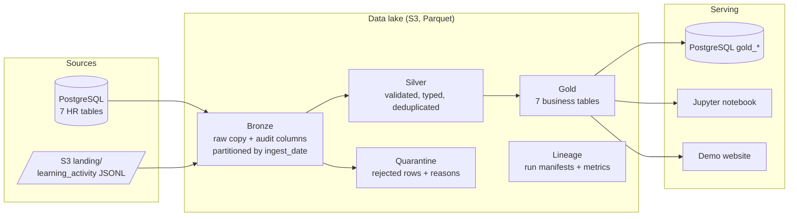

# ACME Talent Insights Pipeline

A batch ETL pipeline that turns ACME's HR data (PostgreSQL) and learning-activity events (JSONL on S3)
into trusted, analysis-ready tables that answer seven talent questions. It is built with PySpark and
Pydantic on a **Bronze → Silver → Gold** data lake and deployed to AWS (EKS + Aurora PostgreSQL + S3).

| | |
|---|---|
| **Live demo website** | <https://dn227wzzn9c8t.cloudfront.net> (results of the cloud run) |
| **Latest cloud run** | `20261015T080710Z-e6bae6`, `SUCCEEDED` in 218 s on EKS |
| **Tests** | 153 passing, 98% coverage ([docs/testing.md](docs/testing.md)) |
| **Notebook** | [notebooks/talent_insights.ipynb](notebooks/talent_insights.ipynb) (static copy: [talent_insights_report.html](notebooks/talent_insights_report.html)) |
| **Lineage** | [docs/source_to_target.md](docs/source_to_target.md) and [docs/joins_details.pdf](docs/joins_details.pdf) |
| **Requirements** | [docs/data-engineer.md](../../docs/data-engineer.md) (workshop guide) |

---

## 1. Business questions and where each is answered

Each question has **one Gold table**. Tables are written as Parquet to `<lake>/gold/<table>` and copied
to PostgreSQL as `gold_<table>`, so they can be queried with plain SQL.

| # | Question | Gold table | Grain (one row per) |
|---|----------|------------|---------------------|
| 1 | What are employees' performance ratings and review history? | `employee_performance_history` | employee × review period |
| 2 | Where are the critical skill gaps? | `skill_gaps` | employee × competency |
| 3 | Which high-potential employees are ready for promotion? | `promotion_pipeline` | employee |
| 4 | What training has each employee completed? | `employee_learning_summary` | employee |
| 5 | Who is at risk of leaving? | `attrition_risk` | employee |
| 6 | How does performance relate to team and project outcomes? | `team_performance_outcomes` | team |
| 7 | How are skills distributed across the organisation? | `skill_distribution` | competency × proficiency level |

Business rules are named constants at the top of `job.py` section 13. They are also written into every
run's manifest (`business_rules`), so the notebook and website read the rules the run actually used:

| Rule | Value |
|------|-------|
| Critical skill gap | required level − current level ≥ **2** |
| High performer | latest rating ≥ **4** |
| Promotion candidate | potential = *High*, readiness = *Ready Now*, latest rating ≥ **4** |
| Attrition risk score | HR flag High **+3**, Medium **+1**; rating dropped **+2**; latest rating ≤ 2 **+1**; no learning for 180 days **+1** |
| Risk tier | score ≥ **4** High, ≥ **2** Medium, otherwise Low |

---

## 2. Architecture



The job runs four steps in order: `check → bronze → silver → gold`.

| Step | What it does |
|------|--------------|
| **check** | Fails fast before any work if PostgreSQL or S3 can't be reached, or if the lake can't be written to. |
| **bronze** | Copies each source as-is and adds audit columns (`_source_system`, `_source_object`, `_source_file`, `_ingested_at`, `_bronze_run_id`). JSON lines stay as raw text so that bad records are never lost at this stage. Checks that the rows written equal the rows read. |
| **silver** | Validates every row against a **Pydantic contract** (types, ranges, allowed values, dates not in the future). Also removes duplicates, checks foreign keys, and checks that each event's date matches its landing folder date. Rejected rows go to `quarantine/<table>` with the stage (`schema`, `partition` or `referential`), the reason and the original record. Reconciliation must balance: `rows_in = kept + quarantined + duplicates`. |
| **gold** | Joins and aggregates Silver into the 7 tables. Checks each table's grain (no duplicate keys) and checks totals against Silver. Then publishes the tables to PostgreSQL. |

The lake layout is `<lake>/{bronze, silver, quarantine, gold, lineage}`. The lake is LocalStack S3 when
running locally and `s3a://coding-workshop-datalake-<participant_id>` on AWS.

### The cloud deployment

```
Terraform (infra/) ──> EKS cluster ──> Helm Job "talent-pipeline" (job.py + requirements.txt)
                           │                │ reads/writes
                           │                ├──> Aurora PostgreSQL Serverless v2 (sources + gold_*)
                           │                └──> S3 data lake bucket (landing + Bronze/Silver/Gold)
CloudFront + S3 ──> demo website (frontend/)
```

---

## 3. Repository layout

```
data/talent-pipeline/
├── job.py                     # the whole deployable pipeline (14 sections, see its docstring)
├── requirements.txt           # runtime dependencies, pinned; shipped with job.py to the cloud
├── requirements-dev.txt       # + tests, notebook, lint tooling
├── env.local                  # local settings (local Postgres + LocalStack); no real secrets
├── pytest.ini, ruff.toml      # test markers / lint rules
├── scripts/
│   ├── seed_sources.sh        # loads the sample data into Postgres + S3 landing zone, verifies counts
│   ├── seed_cloud_postgres.sh # seeds Aurora from a temporary pod inside the cluster
│   ├── perf_test.py           # performance test at 1x / 5x / 10x volume
│   └── export_site_data.py    # reads the lake and writes frontend/src/data/insights.json
├── tests/                     # 11 test files: unit, integration, end-to-end
├── notebooks/                 # talent_insights.ipynb + exported HTML report
└── docs/
    ├── source_to_target.md    # column-level lineage
    ├── joins_details.pdf      # how each Gold table is joined from Silver
    └── testing.md             # test evidence, coverage, performance results
```

**Why one `job.py`?** The provided infrastructure (`infra/locals.tf`, `infra/helm/templates/python-job.yaml`)
deploys exactly one script and one `requirements.txt` to a Kubernetes Job. Keeping the pipeline in a
single file means it deploys **without changing how the template ships code**. The file is organised into
numbered sections (configuration, logging, retry, Spark, storage, readers, lineage, health check,
Bronze, contracts, validation, Silver, Gold, orchestration), so it stays easy to navigate.

---

## 4. Run it locally

**Prerequisites:** Java 21, Python 3.13, the workshop's local services (PostgreSQL on `localhost:5432` and
LocalStack on `:4566`, started by `./bin/start-dev.sh`), and the sample data zip in `sampleData/`.

```sh
# 1. One-time: create the virtual environment
python3.13 -m venv .venv
.venv/bin/pip install -r data/talent-pipeline/requirements-dev.txt

# 2. Every new terminal: load local settings (also activates .venv)
source data/talent-pipeline/env.local

# 3. Load the sample data into the source systems (safe to re-run)
./data/talent-pipeline/scripts/seed_sources.sh

# 4. Run the pipeline
python data/talent-pipeline/job.py                         # all steps
python data/talent-pipeline/job.py --steps silver,gold     # selected steps (always run in order)
```

**Exit codes:** `0` success, `1` the pipeline failed (the reason is logged), `2` bad arguments or
configuration.

**Expected result** (key log lines; each line also shows the time, level, run id and step):

```
learning_activity        in= 29868  out= 29574  quarantined=  143  duplicates= 151 -> s3a://.../silver/learning_activity
promotion_pipeline              ... rows -> s3a://.../gold/promotion_pipeline + postgres gold_promotion_pipeline
Lineage manifest written: s3a://.../lineage/...
Pipeline SUCCEEDED
```

**See the results:**

```sh
# Gold tables in PostgreSQL
psql -h localhost -U postgres -c "SELECT * FROM gold_promotion_pipeline LIMIT 10;"

# Lake contents (Bronze / Silver / quarantine / gold / lineage)
aws --endpoint-url "$AWS_ENDPOINT_URL" s3 ls "s3://$LAKE_BUCKET/" --recursive | head

# Notebook (choose the "talent-pipeline" kernel)
jupyter notebook data/talent-pipeline/notebooks/talent_insights.ipynb
```

> LocalStack does not keep data when it restarts. If the lake is empty, run steps 3 and 4 again.

### Configuration

All settings come from environment variables. Nothing is hardcoded, and missing values stop the job
at start-up with a clear error.

| Variable | Purpose | Default |
|----------|---------|---------|
| `POSTGRES_HOST` / `PORT` / `NAME` / `USER` / `PASS` | source database and the Gold publish target | required |
| `LAKE_BUCKET` (or `LAKE_ROOT`) | data lake location | required |
| `AWS_ENDPOINT_URL` | S3 endpoint (LocalStack); not set on AWS | — |
| `AWS_REGION` | S3 region | `us-east-1` |
| `IS_LOCAL` | `false` turns on SSL for PostgreSQL (`sslmode=require`) | `true` |
| `RUN_DATE` | which Bronze partition to process (`YYYY-MM-DD`) | today (UTC) |
| `PUBLISH_GOLD_TO_POSTGRES` | also write `gold_*` tables to PostgreSQL | `true` |
| `SPARK_CORES` / `SPARK_DRIVER_MEMORY` / `SPARK_JAVA_OPTIONS` | Spark resource tuning | all cores / `512m` / lean JVM flags |

---

## 5. Deploy to AWS

```sh
# 1. Fresh credentials in a clean terminal (do NOT source env.local here; credentials last about 1 hour)
./bin/setup-participant.sh && source ENVIRONMENT.config && export AWS_REGION=ap-south-1

# 2. Infrastructure + the pipeline job (EKS, Aurora, S3 data lake, Helm Job)
export TF_VAR_aws_eks_enabled=true
./bin/deploy-backend.sh aws

# 3. Load the sources: landing files to S3, HR tables to Aurora (from a pod, since Aurora is private)
LAKE_BUCKET=coding-workshop-datalake-$PARTICIPANT_ID ./data/talent-pipeline/scripts/seed_sources.sh --s3-only
./data/talent-pipeline/scripts/seed_cloud_postgres.sh

# 4. Run the job again after seeding and follow its logs
./bin/deploy-backend.sh aws
kubectl get jobs
kubectl logs -f job/<talent-pipeline job name>

# 5. Publish the demo website with the cloud results
python data/talent-pipeline/scripts/export_site_data.py
./bin/deploy-frontend.sh aws
```

The job receives its settings from Terraform (`local.data_job_env` in `infra/datalake.tf`). They are
passed to Helm through environment variables and stored in a **Kubernetes Secret**, so the database
password never appears in Terraform output or in the job's pod definition. The pod reads S3 with the
EKS node's IAM role, so **no AWS keys are in the code or in the configuration**.

---

## 6. Test

```sh
cd data/talent-pipeline && source env.local
pytest -m "not integration and not e2e"     # unit tests, no services needed
pytest -m integration                       # against PostgreSQL + S3
pytest -m e2e                               # runs the real job twice: smoke test + idempotency
pytest --cov=job --cov-report=term-missing  # everything, with coverage
ruff check .
python scripts/perf_test.py                 # 1x / 5x / 10x volume
```

| Result | Value |
|--------|-------|
| Tests | **153 passed** |
| Coverage | **98%** overall. Bronze, Gold and contracts: 100%. Retry and error paths: 96%. |
| Idempotency | Two full runs give identical reconciliation and no duplicate rows |
| Performance | 10x volume (420k rows) in 105 s on 1 core, peak 1.9 GB (fits the 2 GiB pod limit) |
| SLA | full run takes about 85 s locally and 218 s on EKS, against a 600 s limit |

Full evidence, coverage by area, and the bugs the tests found are in [docs/testing.md](docs/testing.md).

---

## 7. Data quality: what the pipeline catches

The sample data contains deliberate problems. Every one is caught and explained, and none is silently
dropped:

| Problem in the source | Count | What happens |
|-----------------------|------:|--------------|
| Malformed JSON lines | 13 | quarantined (`schema`) with the parse error and the raw line |
| Duplicate `event_id`s | 152 | 151 dropped as duplicates (1 was also invalid, so both copies were quarantined) |
| Missing `employee_id` | 76 | quarantined (`schema`) |
| Invalid or future dates, or dates that don't match the landing folder | 54 | quarantined (`schema` / `partition`) |
| Schema drift: `notes` instead of `text` | 39 | renamed to `text` and kept; any other unknown field is logged as a warning |
| Empty landing file | 1 | listed and warned about; it does not break the run |
| Unknown employee or competency (orphan foreign keys) | — | quarantined (`referential`) |

Learning events: **29,868 in → 29,574 kept + 143 quarantined + 151 duplicates**, with identical numbers
locally and on AWS.

---

## 8. Design decisions and trade-offs

| Decision | Why | Trade-off |
|----------|-----|-----------|
| **Medallion layers** (Bronze/Silver/Gold) | Raw data is kept, so any layer can be rebuilt; each layer has one job | More storage and more steps than a single transform |
| **Idempotent writes**: Bronze overwrites only today's `ingest_date` partition; Silver and Gold are fully refreshed | Re-running a day never creates duplicates, and failed runs are safe to repeat | A full refresh re-reads all of Silver; fine at this volume, but large data would need incremental merges |
| **Pydantic contracts** run inside Spark (`mapInPandas`) | One readable, testable definition of each schema; error messages per field | Python per row is slower than native Spark expressions (about 290k rows/min per core); see Limitations |
| **Quarantine, not drop** | Every rejected row keeps its reason and original record, so the business can fix the source | One extra dataset per table |
| **Lineage at three levels**: audit columns per row, a manifest per run (steps, counts, rules, config without secrets), and a column-level mapping document | Answers "where did this number come from?" at any level | The column mapping document must be kept up to date by hand |
| **Point-in-time Gold**: only events up to `RUN_DATE` count | Re-running an old date reproduces the same answer | — |
| **Retry with exponential backoff** (3 attempts, 2 s → 4 s) on PostgreSQL and S3 calls; JDBC `connectTimeout` 30 s | Survives temporary network errors and Aurora Serverless waking up from auto-pause | A real outage takes about 10 s longer to report |
| **Lean JVM defaults** (512 MB heap, SerialGC, capped JVM memory areas) and `SPARK_CORES=1` in the cloud | The first measurement peaked at 2.3 GB, which would have been OOM-killed by the 2 GiB pod limit; now it peaks at 1.8 GB | Less parallelism; acceptable at this volume |
| **Gold also published to PostgreSQL** | Analysts can use SQL without Spark | Two copies of Gold; Parquet is the source of truth |

---

## 9. Changes made to the provided infrastructure

These gaps were found while deploying. Each fix is a small, commented change:

| File | Gap | Fix |
|------|-----|-----|
| `infra/datalake.tf` (new) | No data lake bucket, and the EKS role had no S3 access | Private bucket with public access blocked, plus an S3 policy on the EKS role that covers only this bucket |
| `infra/eks.tf`, `infra/helm/values.yaml`, `templates/python-job.yaml` | The Helm Job received no environment variables | Settings passed through a Kubernetes Secret + `envFrom`, without printing secrets |
| `infra/eks.tf`, `values.yaml` | Pods could not get IAM credentials (the EC2 metadata hop limit is 1) | `hostNetwork: true` for the job pod, with `dnsPolicy: ClusterFirstWithHostNet` |
| `infra/rds.tf` | Pods could not reach Aurora (Aurora was not in the EKS cluster's security group) | Aurora also joins the EKS cluster security group (1 line) |
| `infra/provider.tf` | Terraform kept trying to remove account-managed `ams:` tags | `ignore_tags { key_prefixes = ["ams:"] }` |
| `.gitignore` | Sample data, the local lake and Spark files could be committed by mistake | Added ignore entries |

### Security finding (not changed; recommendation)

The provided `infra/rds.tf` generates the Aurora master password with `random_pet`, which produces
readable words. Its value is stored in plain text in the Terraform state and is printed by
`terraform refresh`. **Recommendation:** use `manage_master_user_password = true`, so AWS creates and
rotates the password in Secrets Manager, and have the job read it from there (or use IAM database
authentication). This was left unchanged because it changes how the whole workshop's infrastructure
handles credentials.

---

## 10. Assumptions and limitations

- **Batch, one run per day.** `RUN_DATE` selects the Bronze partition. There is no streaming and no
  change-data-capture.
- **Full refresh of Silver and Gold.** Simple and correct at this size (about 42k rows). For millions of
  rows, switch to incremental merges (for example Delta Lake or Iceberg `MERGE`).
- **Row validation in Python.** For hundreds of millions of rows, translate the contracts into native
  Spark expressions and repartition before validation.
- **The "date not in the future" rule uses today's date**, not `RUN_DATE`. Re-running an old date with
  events after that date would accept them in Silver. Gold still ignores them because of its
  point-in-time filter.
- **Business rule values are code constants.** They are recorded in every run manifest but can't be
  changed through environment variables.
- **Local Spark mode** (one pod) is enough for this volume. A larger dataset would use Spark on
  Kubernetes or EMR.
- Spark sometimes logs a harmless `ERROR Inbox: Ignoring error` at start-up or shutdown. It never
  affects the results or the exit code ([docs/testing.md](docs/testing.md) §4).

---

## 11. Cost and cleanup

The AWS resources (EKS cluster, Aurora, CloudFront) **cost money while they exist**. When the
workshop's evaluation is finished, remove them with:

```sh
./bin/cleanup-environment.sh
```

This deletes the cloud environment, including the database and the data lake. Run it only once the
demo is no longer needed.
