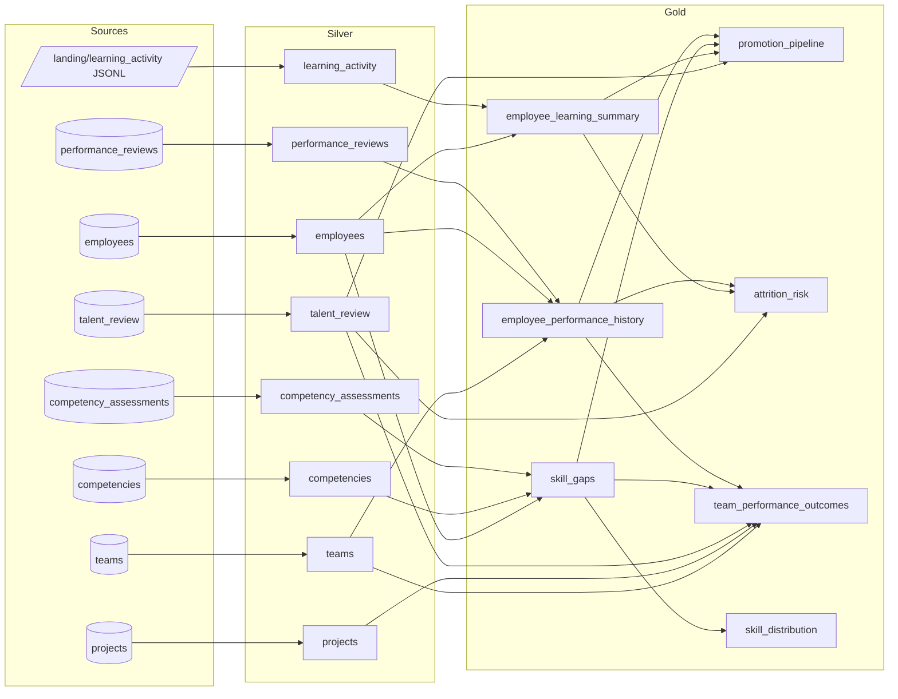

# Source-to-Target Mapping (Data Lineage)

This document traces every dataset and column from the source systems through
Bronze and Silver to Gold, and states exactly where columns are **renamed**,
**cast**, **derived** or **aggregated**. Everything referenced below lives in
[`job.py`](../job.py): contracts in section 10 (*Schema contracts*), Silver rules in
section 12, and the business-rule constants at the top of section 13 (*Gold*).

## 1. Dataset lineage

Every source dataset passes through Bronze unchanged (`<source> -> bronze/<dataset>`),
omitted from the diagram for readability.

## 2. Storage layout

| Zone | Path | Format | Partitioning | Write mode |
|------|------|--------|--------------|------------|
| Landing | `landing/learning_activity/year=/month=/day=/*.jsonl` | JSON Lines | source-defined | written by source system |
| Bronze | `bronze/<dataset>/` | Parquet | `ingest_date` | dynamic partition overwrite (rerun replaces that date only) |
| Silver | `silver/<table>/` | Parquet | `event_year` (learning_activity only) | full refresh (static overwrite) |
| Quarantine | `quarantine/<table>/run_date=YYYY-MM-DD/` | Parquet | `run_date` | overwrite per run date |
| Gold | `gold/<table>/` + Postgres `gold_<table>` | Parquet / table | none | full refresh |
| Lineage | `lineage/runs/run_date=/<run_id>.json`, `lineage/dataset_metrics/run_date=/` | JSON / Parquet | `run_date` | append (audit log) |

## 3. Row-level lineage columns

| Column | Added in | Meaning |
|--------|----------|---------|
| `_ingested_at` | Bronze | UTC timestamp the row was landed in Bronze |
| `_source_system` | Bronze | `postgres` or `s3` |
| `_source_object` | Bronze | Source table (`public.employees`) or landing directory |
| `_source_file` | Bronze | Exact landing file of a JSONL line (learning_activity only) |
| `_run_id` → `_bronze_run_id` | Bronze → renamed in Silver | Run that landed the row |
| `ingest_date` | Bronze | Partition = run date; dropped in Silver |
| `_processed_at`, `_run_id` | Silver | When / which run validated the row |
| `_dq_stage`, `_dq_errors`, `_dq_raw`, `_quarantined_at` | Quarantine | Why a row was rejected, plus the original record |
| `_generated_at`, `_run_id` | Gold | When / which run built the dataset |

## 4. Bronze → Silver (per table)

All Silver tables: validated against the table's Pydantic contract, de-duplicated on the
primary key, foreign keys checked against the parent's valid Silver rows. Integer
columns are **cast** to `bigint` (contract type `int`). Strings are trimmed.

| Silver table | Primary key | Foreign keys | Column transformations |
|--------------|-------------|--------------|------------------------|
| `teams` | `team_id` | – | none |
| `competencies` | `competency_id` | – | `category` must be Technical / Leadership / Domain |
| `employees` | `employee_id` | `team_id → teams` | `email` format check; `hire_date` not in future |
| `projects` | `project_id` | `team_id → teams` | `outcome_score` **cast** numeric(5,2) → double, range 0–100 |
| `performance_reviews` | `review_id` | `employee_id → employees` | **derived** `period_year` = substr(`review_period`, 1, 4); `period_half` = substr(`review_period`, 7, 1) |
| `competency_assessments` | `assessment_id` | `employee_id → employees`, `competency_id → competencies` | levels 1–5 |
| `talent_review` | `employee_id` | `employee_id → employees` | enum checks on ratings |
| `learning_activity` | `event_id` | `employee_id → employees` | `raw_line` **parsed** from JSON; `notes` **renamed** → `text` (schema drift); `employee_id` **cast** string → bigint; `event_date` **cast** string → timestamp; `score` required only for quiz events; date of `event_date` must equal the landing folder's `year=/month=/day=` (else quarantined, stage `partition`); unknown JSON fields are reported as schema drift; **derived** `event_day` = to_date(`event_date`), `event_year` = year(`event_date`) |

## 5. Silver → Gold (per column)

### 5.1 `employee_performance_history` — one row per employee × review period

| Column | Source | Transformation |
|--------|--------|----------------|
| `employee_id`, `review_id`, `review_period`, `period_year`, `period_half`, `rating`, `manager_comment`, `submitted_date` | `silver.performance_reviews` | passthrough |
| `full_name` | `silver.employees.first_name`, `last_name` | **derived**: concat with a space |
| `job_level` | `silver.employees` | passthrough (join on `employee_id`) |
| `team_name` | `silver.teams.name` | **renamed** (join on `team_id`) |
| `department` | `silver.teams` | passthrough |
| `review_seq` | – | **derived**: row_number per employee ordered by period |
| `previous_rating` | `rating` | **derived**: lag(rating) per employee ordered by period |
| `rating_change` | `rating`, `previous_rating` | **derived**: rating − previous_rating |
| `rating_trend` | `rating_change` | **derived**: first review / improved / stable / declined |

### 5.2 `skill_gaps` — one row per employee × competency

| Column | Source | Transformation |
|--------|--------|----------------|
| `employee_id`, `competency_id`, `proficiency_level`, `required_level`, `assessed_date` | `silver.competency_assessments` | passthrough |
| `competency_name` | `silver.competencies.name` | **renamed** |
| `category` | `silver.competencies` | passthrough |
| `full_name`, `department`, `team_name`, `job_level` | employees + teams | as in 5.1 |
| `gap` | `required_level`, `proficiency_level` | **derived**: required − proficiency (positive = shortfall) |
| `gap_severity` | `gap` | **derived**: critical (≥ `CRITICAL_GAP_LEVELS`=2) / moderate (1) / none (≤0) |
| `is_critical_gap` | `gap` | **derived**: gap ≥ 2 |

### 5.3 `employee_learning_summary` — one row per employee (all employees, zeros if no activity)

| Column | Source (`silver.learning_activity`) | Transformation |
|--------|--------|----------------|
| `total_events` | all events | **aggregated**: count |
| `courses_engaged` | `course_name` | **aggregated**: count distinct |
| `courses_enrolled` | `course_name` where `event_type`=enrollment | **aggregated**: count distinct |
| `courses_completed` | `course_name` where course_completed | **aggregated**: count distinct |
| `certifications_earned` | `course_name` where certification_earned | **aggregated**: count distinct |
| `quiz_events` / `quizzes_passed` | quiz_attempted + quiz_passed / quiz_passed | **aggregated**: count |
| `avg_quiz_score` | `score` | **aggregated**: avg, rounded to 1 dp |
| `first_activity_date` / `last_activity_date` | `event_day` | **aggregated**: min / max |
| `completed_courses` | `course_name` where course_completed | **aggregated**: sorted distinct list |
| `completion_rate` | | **derived**: courses_completed / courses_engaged (2 dp) |
| `days_since_last_activity` | `last_activity_date` | **derived**: run_date − last_activity_date |

### 5.4 Employee profile (intermediate, not stored) — feeds 5.5, 5.6, 5.7

| Column | Source | Transformation |
|--------|--------|----------------|
| `latest_period`, `latest_rating` | `employee_performance_history` | **renamed** from the most recent review per employee |
| `previous_rating`, `rating_change`, `rating_trend` | `employee_performance_history` | from the most recent review |
| `avg_rating`, `review_count` | `employee_performance_history.rating` | **aggregated**: avg (2 dp), count |
| `hr_attrition_risk` | `silver.talent_review.attrition_risk` | **renamed** |
| `potential_rating`, `promotion_readiness`, `review_cycle` | `silver.talent_review` | passthrough |
| `critical_gap_count`, `competencies_assessed` | `skill_gaps` | **aggregated**: count where critical / count |
| `tenure_years` | `silver.employees.hire_date` | **derived**: (run_date − hire_date) / 365.25, 1 dp |

### 5.5 `promotion_pipeline` — one row per employee

| Column | Transformation |
|--------|----------------|
| profile columns | passthrough from 5.4 |
| `is_high_potential` | **derived**: potential_rating = High |
| `is_promotion_candidate` | **derived**: High potential AND readiness = Ready Now AND latest_rating ≥ `PROMOTION_MIN_RATING` (4) |
| `pipeline_stage` | **derived**: Promote now (candidate, 0 critical gaps) / Promote after closing skill gaps (candidate) / Develop (high potential) / Not in pipeline |

### 5.6 `attrition_risk` — one row per employee

| Column | Transformation |
|--------|----------------|
| profile columns | passthrough from 5.4 (+ `days_since_last_activity` from 5.3) |
| `risk_score` | **derived**: HR High +3 / Medium +1; rating declined +2; latest_rating ≤ 2 +1; no learning in 180 days +1 (`RISK_POINTS`) |
| `risk_tier` | **derived**: High (score ≥ 4) / Medium (≥ 2) / Low |
| `risk_factors` | **derived**: list of the human-readable reasons that contributed points |

### 5.7 `team_performance_outcomes` — one row per team

| Column | Source | Transformation |
|--------|--------|----------------|
| `team_id`, `team_name`, `department` | `silver.teams` | `name` **renamed** to `team_name` |
| `headcount` | profile | **aggregated**: count of employees |
| `avg_latest_rating`, `avg_rating_change`, `avg_critical_gaps` | profile | **aggregated**: avg (2 dp) |
| `high_performer_share` | profile `latest_rating` | **aggregated**: share with rating ≥ 4 |
| `hr_high_risk_count` | profile `hr_attrition_risk` | **aggregated**: count = High |
| `project_count`, `avg_outcome_score` | `silver.projects` | **aggregated**: count, avg (2 dp) |
| `on_time_share` | `silver.projects.outcome_status` | **aggregated**: share = on-time |
| `troubled_projects` | `silver.projects.outcome_status` | **aggregated**: count in (at-risk, cancelled) |
| `has_projects` | `project_count` | **derived**: project_count > 0 |

### 5.8 `skill_distribution` — one row per department × competency × proficiency level

| Column | Source | Transformation |
|--------|--------|----------------|
| `department`, `category`, `competency_name`, `proficiency_level` | `skill_gaps` | group-by keys |
| `employees` | `skill_gaps.employee_id` | **aggregated**: count distinct |
| `critical_gaps` | `skill_gaps.is_critical_gap` | **aggregated**: count where true |
| `share_of_competency` | `employees` | **derived**: employees / total employees for the department × competency (3 dp) |

## 6. Reconciliation checks enforced by the pipeline

| Layer | Check | Failure behaviour |
|-------|-------|-------------------|
| Bronze | source rows = rows read back from the written partition | `BronzeWriteError`, run fails |
| Bronze | source returned > 0 rows | `EmptySourceError`, run fails |
| Bronze | empty landing files | `WARNING` (no data lost) |
| Bronze | landing file count and total bytes logged (compared with the source export by `scripts/seed_sources.sh`) | – |
| Silver | rows_in = rows_out + quarantined + duplicates | `SilverCheckError`, run fails |
| Silver | written table not empty, zero null primary keys, column types equal the contract | `SilverCheckError`, run fails |
| Silver | known schema drift (`notes` → `text`) | `WARNING`, field renamed |
| Silver | unknown field in source records | `WARNING`, field ignored (contract update needed) |
| Silver | record date ≠ landing partition date | row quarantined (stage `partition`) |
| Gold | table not empty; grain keys unique and non-null for every table | `GoldCheckError`, run fails |
| Gold | history rows = Silver reviews; skill_gaps rows = Silver assessments; per-employee tables = Silver employees; team rows = Silver teams; Σ headcount = employees; Σ learning events = Silver events; Σ skill_distribution employees = assessments | `GoldCheckError`, run fails |
